# Glosario máster de comentarios del cliente

Fuente: `Novartis-Urticaria-Pantallas-sitio (2).pptx` (104 diapositivas, de donde salen los comentarios del cliente). Los comentarios están copiados tal cual, con sus errores de escritura. Cada diapositiva aparece aunque no tenga comentarios.

**Cómo usarlo:** busca el número de diapositiva o el tema. Cada entrada trae el comentario, qué muestra la captura de pantalla, qué implica y la imagen (en `glosario-img/`).

**Números:** son los de la presentación original. En la versión v2 las diapositivas de Home (4 a 14) se reemplazaron: de la 15 en adelante el número baja 3 (original 21 = v2 18).

**Veredictos:** Sí, aplicar · Requiere decisión (Novartis, Legal o contenido médico) · No aplica / sin sentido. Son mi lectura; no son parte del comentario del cliente.

---

## Resumen

- Diapositivas: 104. Con comentarios del cliente: 44. Sin comentarios: 60.

---

## Slide 1 · Portada

Slide en v2: 1

**Comentario del cliente:** sin comentarios.

---

## Slide 2 · Índice de secciones y capturas

Slide en v2: 2

**Comentario del cliente:** sin comentarios.

---

## Slide 3 · Divisoria · Sección 01 Home y variantes contextuales

Slide en v2: 3 · Sección 01

**Comentario del cliente:** sin comentarios.

---

## Slide 4 · Inicio: escenario día: Captura 1 de 7

Slide en v2: reemplazada · Sección: Home

**Comentario del cliente:** sin comentarios.

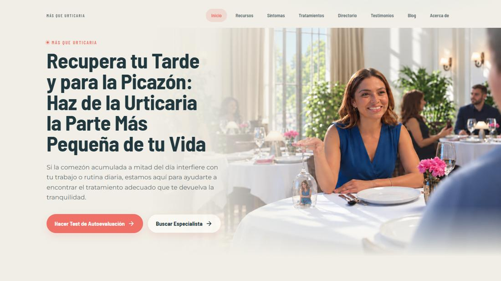

---

## Slide 5 · Inicio: escenario día: Captura 2 de 7

Slide en v2: reemplazada · Sección: Home

**Comentario del cliente:** sin comentarios.

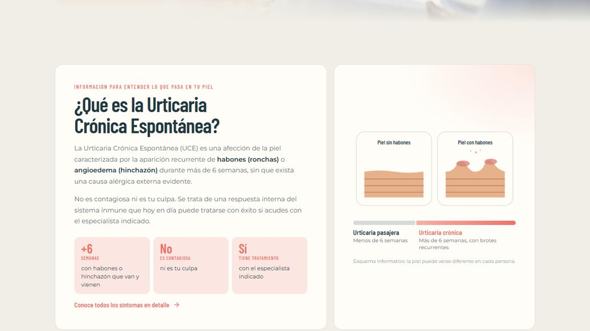

---

## Slide 6 · Inicio: escenario día: Captura 3 de 7

Slide en v2: reemplazada · Sección: Home

**Comentario del cliente:** sin comentarios.

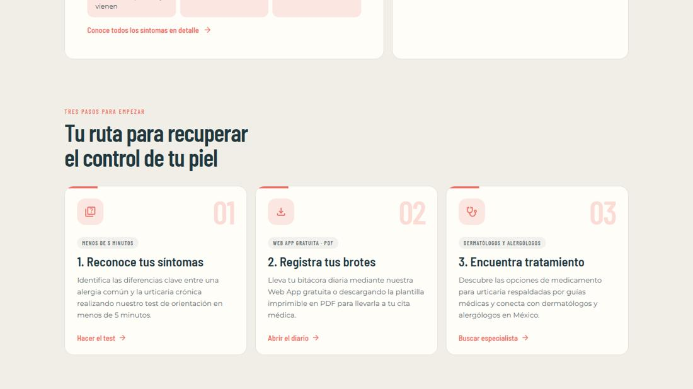

---

## Slide 7 · Inicio: escenario día: Captura 4 de 7

Slide en v2: reemplazada · Sección: Home

**Comentario del cliente:** sin comentarios.

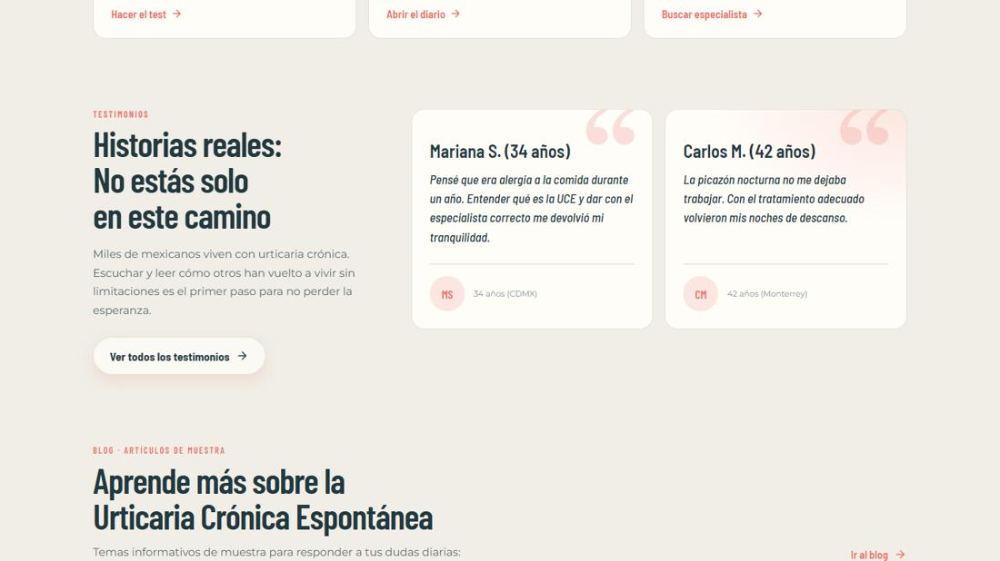

---

## Slide 8 · Inicio: escenario día: Captura 5 de 7

Slide en v2: reemplazada · Sección: Home

**Comentario del cliente:** sin comentarios.

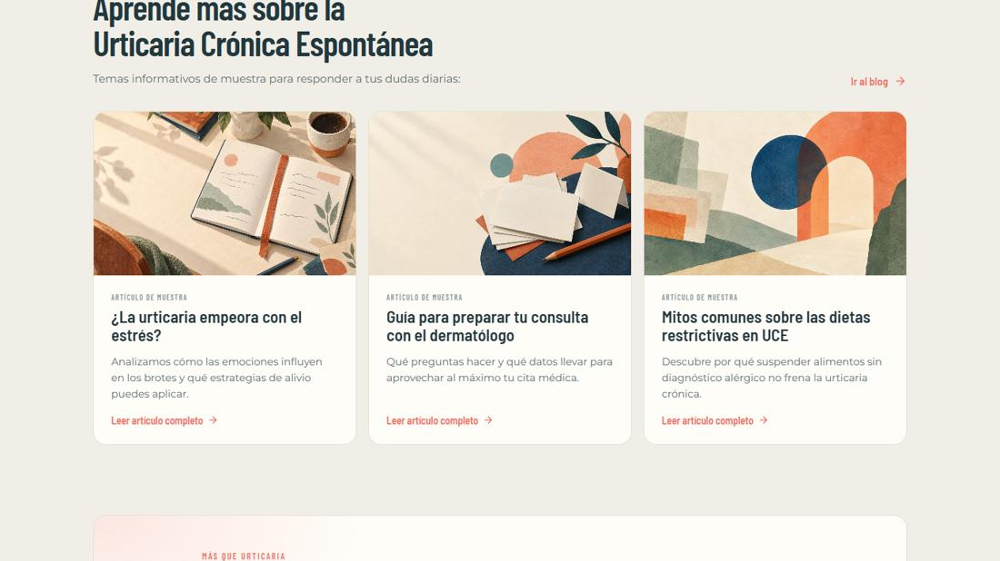

---

## Slide 9 · Inicio: escenario día: Captura 6 de 7

Slide en v2: reemplazada · Sección: Home

**Comentario del cliente:** sin comentarios.

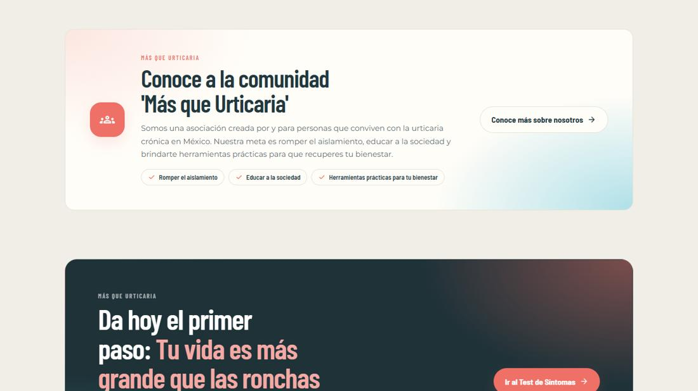

---

## Slide 10 · Inicio: escenario día: Captura 7 de 7

Slide en v2: reemplazada · Sección: Home

**Comentario del cliente:** sin comentarios.

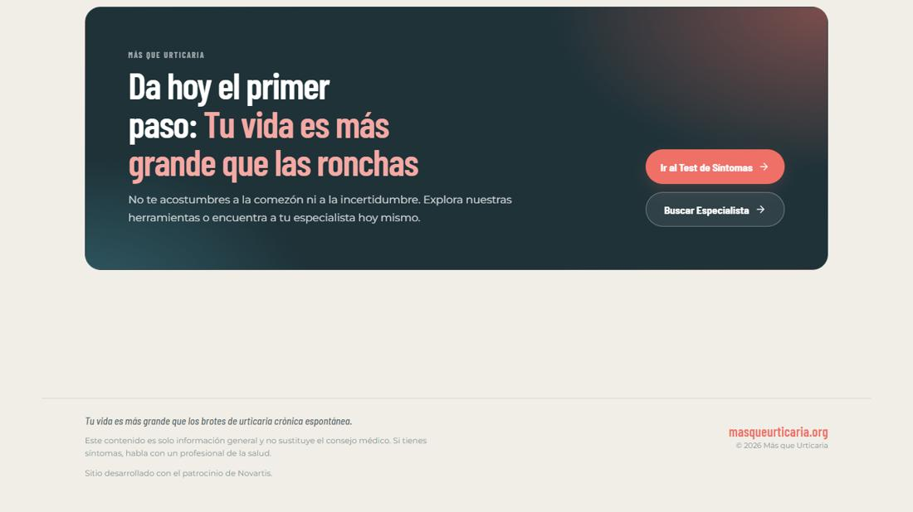

---

## Slide 11 · Inicio: escenario calor

Slide en v2: reemplazada · Sección: Home

**Comentario del cliente:** sin comentarios.

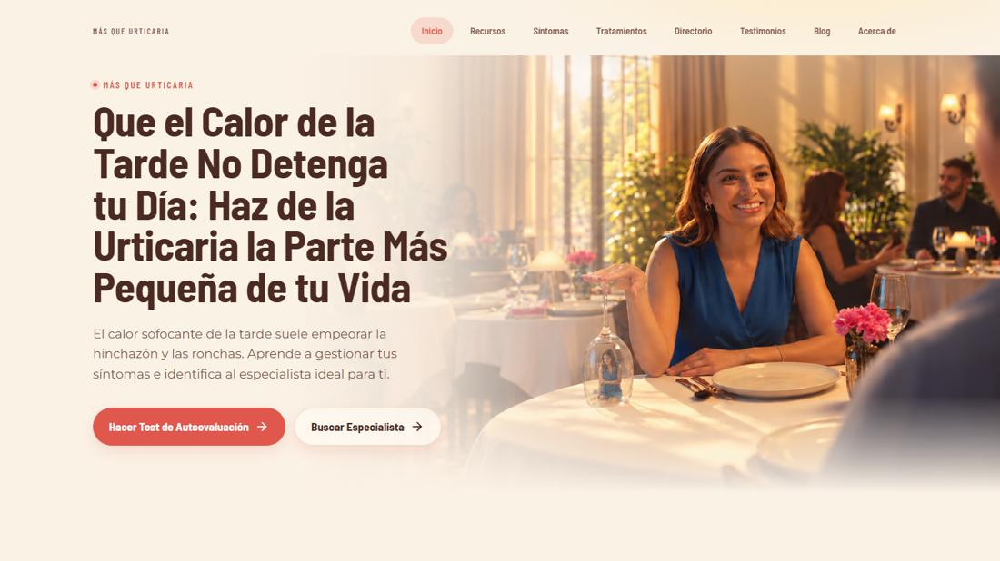

---

## Slide 12 · Inicio: escenario frío

Slide en v2: reemplazada · Sección: Home

**Comentario del cliente:** sin comentarios.

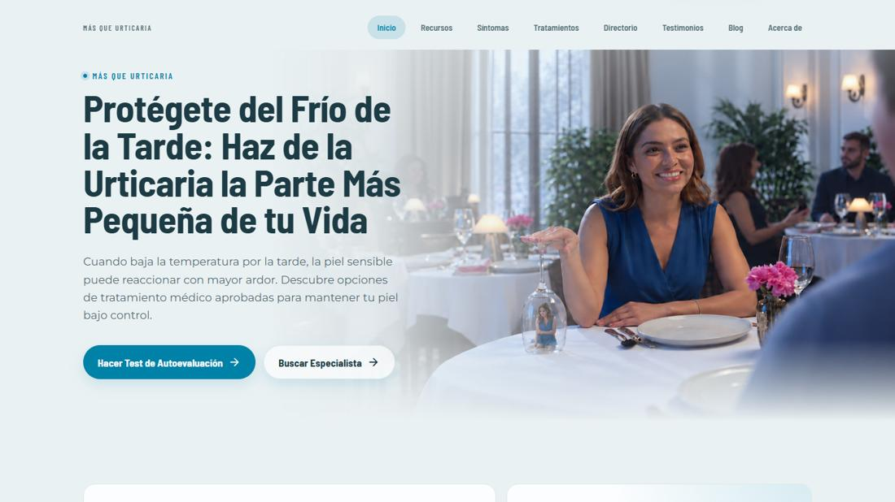

---

## Slide 13 · Inicio: escenario madrugada

Slide en v2: reemplazada · Sección: Home

**Comentario del cliente:** sin comentarios.

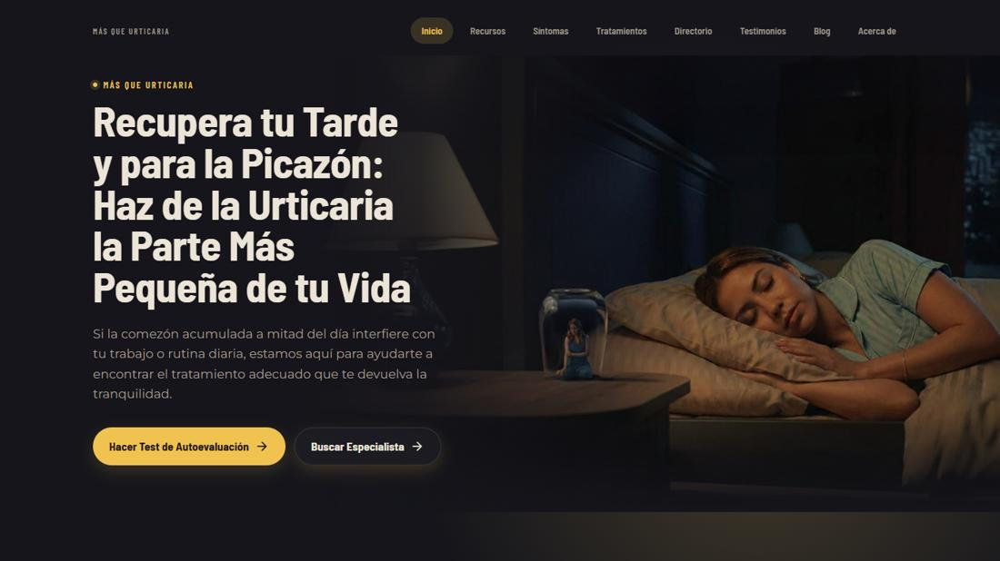

---

## Slide 14 · Inicio: escenario noche cálida

Slide en v2: reemplazada · Sección: Home

**Comentario del cliente:** sin comentarios.

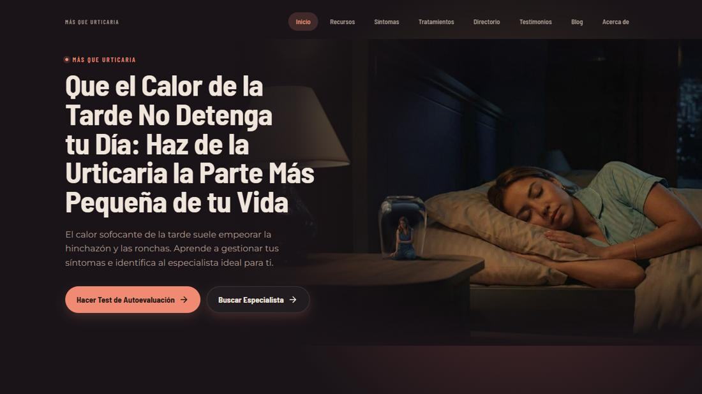

---

## Slide 15 · Divisoria · Sección 02 Síntomas

Slide en v2: 12 · Sección 02

**Comentario del cliente:** sin comentarios.

---

## Slide 16 · Síntomas de la UCE (/sintomas/): Captura 1 de 7

Slide en v2: 13 · Sección: Landings

**Comentario del cliente:**
- «espontánea»
- «Pondrán hasta abajo qué es UCE?»

**Qué muestra la captura:** Inicio de Síntomas. Titular «¿Picazón por la tarde? Conoce los síntomas y sus causas», índice «En esta página» con 5 secciones y botón «Comenzar Test de Síntomas».

**Qué implica:** Sí. Mover la tabla comparativa al final y dejar arriba una definición de una línea con los síntomas y las 6 semanas.  
**Veredicto:** Sí, aplicar

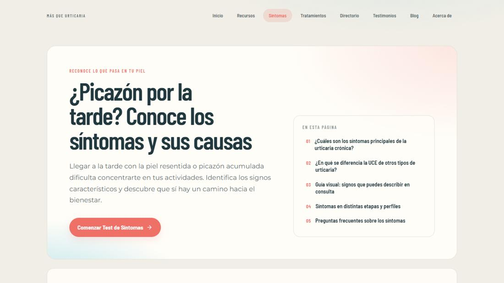

---

## Slide 17 · Síntomas de la UCE (/sintomas/): Captura 2 de 7

Slide en v2: 14 · Sección: Landings Informativas

**Comentario del cliente:**
- «poner imagenes en lugar de la descripción con letra mini»
- «Habones (ronchas)»

**Qué muestra la captura:** Sección 01 «¿Cuáles son los síntomas principales de la urticaria crónica?»: 4 tarjetas solo con texto (Habones o ronchas, Comezón o picazón, Ardor o molestia local, Lesiones cambiantes). El texto usa la sigla UCE.

**Qué implica:** Sí. Una imagen por tarjeta (habones, angioedema, reacción al roce) con el nombre debajo. Imágenes sin IA, con licencia y revisión médica.  
**Veredicto:** Sí, aplicar

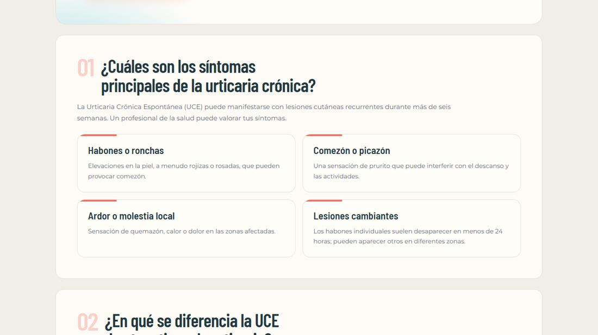

---

## Slide 18 · Síntomas de la UCE (/sintomas/): Captura 3 de 7

Slide en v2: 15 · Sección: Landings Informativas

**Comentario del cliente:** sin comentarios.

**Lo que detecto:** Sin comentario del cliente. Lo que veo: es la sección 02 «¿En qué se diferencia la UCE de otros tipos de urticaria?», una tabla de 3 columnas (urticaria crónica espontánea, aguda, inducible) con filas Detonante, Duración y Evaluación. Puntos a revisar: (1) el título usa la sigla UCE y el acuerdo es escribir el nombre completo; (2) en la fila Detonante de la urticaria inducible aparecen «frío, calor, fricción o presión», que puede reforzar la idea de que el calor causa la enfermedad, justo la confusión que aclararon los asesores; (3) usa «brotes» y «desencadenante», palabras que el cliente pidió cambiar por «ronchas» o evitar; (4) no trae referencias, y se pidió respaldar lo médico con fuentes; (5) la reunión pidió tablas comparativas más creativas.

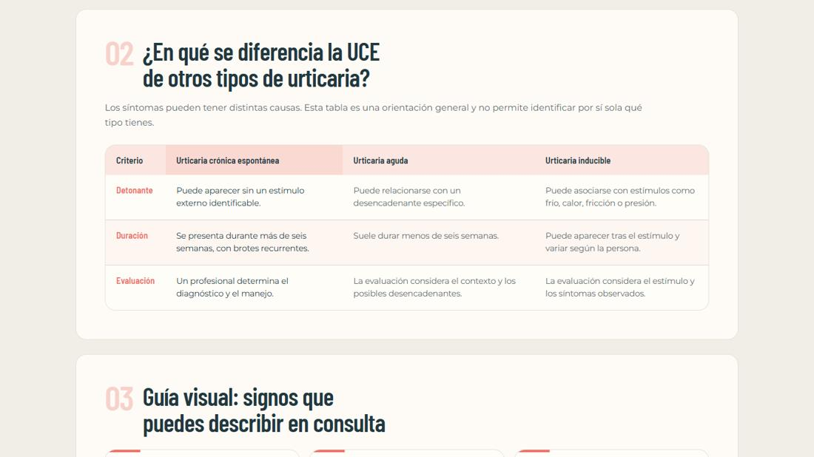

---

## Slide 19 · Síntomas de la UCE (/sintomas/): Captura 4 de 7

Slide en v2: 16 · Sección: Landings Informativas

**Comentario del cliente:**
- «poner imagenes en lugar de la descripción con letra mini»
- «Estos perfiles para qué son? Referencias y objetivo»

**Qué muestra la captura:** Sección 03 «Guía visual: signos que puedes describir en consulta» (Habones y ronchas, Angioedema o hinchazón, Reacción al roce) y sección 04 «Síntomas en distintas etapas y perfiles» (Mujeres, Niños, Hombres). Todo en texto, sin imágenes.

**Qué implica:** Imágenes: sí. Perfiles: no tienen objetivo ni fuente, y la reunión acordó eliminarlos.  
**Veredicto:** Sí, aplicar

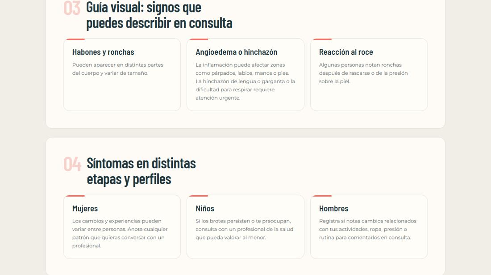

---

## Slide 20 · Síntomas de la UCE (/sintomas/): Captura 5 de 7

Slide en v2: 17 · Sección: Landings Informativas

**Comentario del cliente:**
- «Tenemos evidencia de que empeore por la noche?»
- «Tenemos evidencia / Fuentes confiables ?»

**Qué muestra la captura:** Sección 05 «Preguntas frecuentes sobre los síntomas»: 5 acordeones cerrados (por qué la comezón empeora por la noche, si el estrés causa los brotes, cuánto dura un brote, cicatrices, contagio).

**Qué implica:** La pregunta es correcta: no hay fuente. Quitar la FAQ hasta tener una cita NIH textual, o reformularla sin afirmar nada.  
**Veredicto:** Requiere decisión

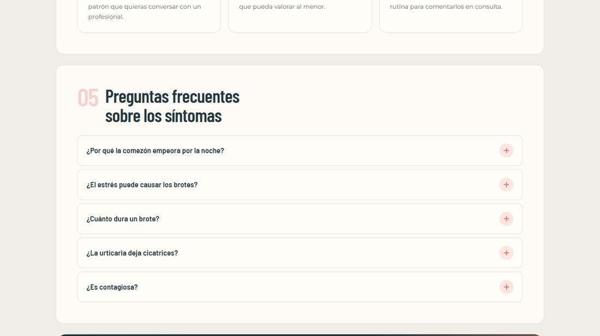

---

## Slide 21 · Síntomas de la UCE (/sintomas/): Captura 6 de 7

Slide en v2: 18 · Sección: Landings Informativas

**Comentario del cliente:**
- «En las letras chiquitas sugiero poner algo tipo: Llegar a tu cita médica con los datos completes de tus síntomas facilita su revision. (buscar un wording amigable)»

**Qué muestra la captura:** Cierre «Lleva un registro para tu próxima consulta» con botón al Diario, y pie de página con leyenda informativa, «Sitio desarrollado con el patrocinio de Novartis» y el dominio.

**Qué implica:** Sí. Propuesta: «Llega a tu cita con tus síntomas anotados: tu médico podrá valorarlos mejor.»  
**Veredicto:** Sí, aplicar

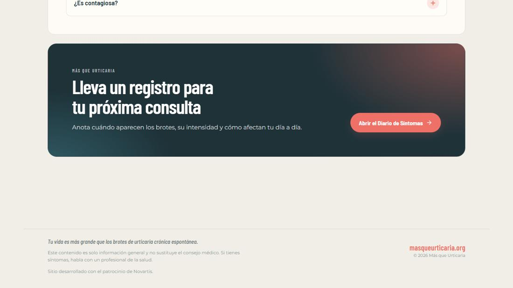

---

## Slide 22 · Síntomas de la UCE (/sintomas/): Captura 7 de 7

Slide en v2: 19 · Sección: Landings Informativas

**Comentario del cliente:** sin comentarios.

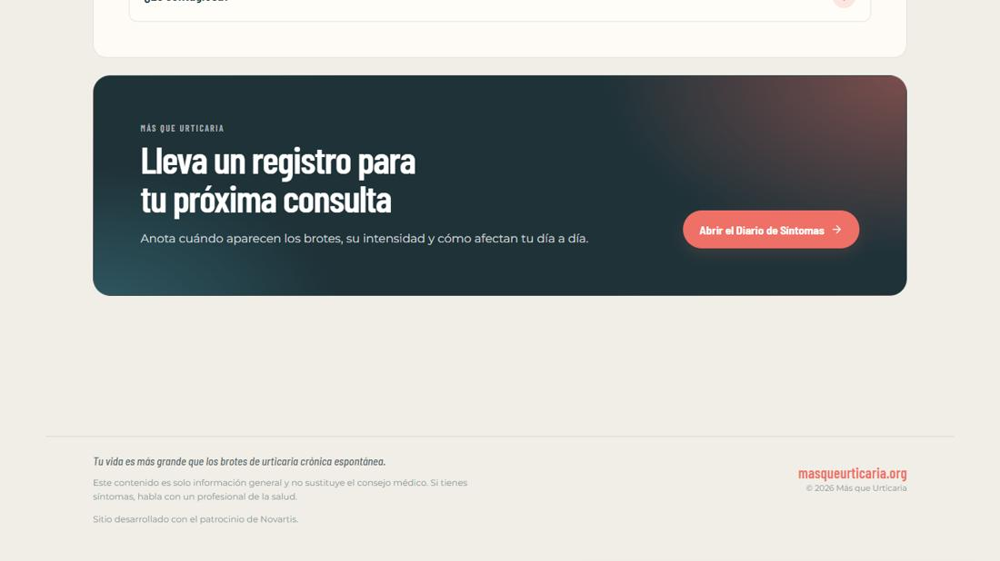

---

## Slide 23 · Tratamientos para la UCE (/tratamiento/): Captura 1 de 7

Slide en v2: 20 · Sección: Landings Informativas · Vista 20 De 124

**Comentario del cliente:**
- «Comezón y misma pregunta de “la tarde”»

**Qué muestra la captura:** Inicio de Tratamientos. Titular «¿La picazón de la tarde interfiere con tus actividades? Opciones de tratamiento para mantener el control», párrafo sobre llegar frustrado a la tarde, botón «Buscar Especialista» e índice de 6 secciones.

**Qué implica:** El título y el párrafo repiten la idea de «la tarde». Dejar una sola formulación. El comentario es ambiguo: confirmar.  
**Veredicto:** Requiere decisión

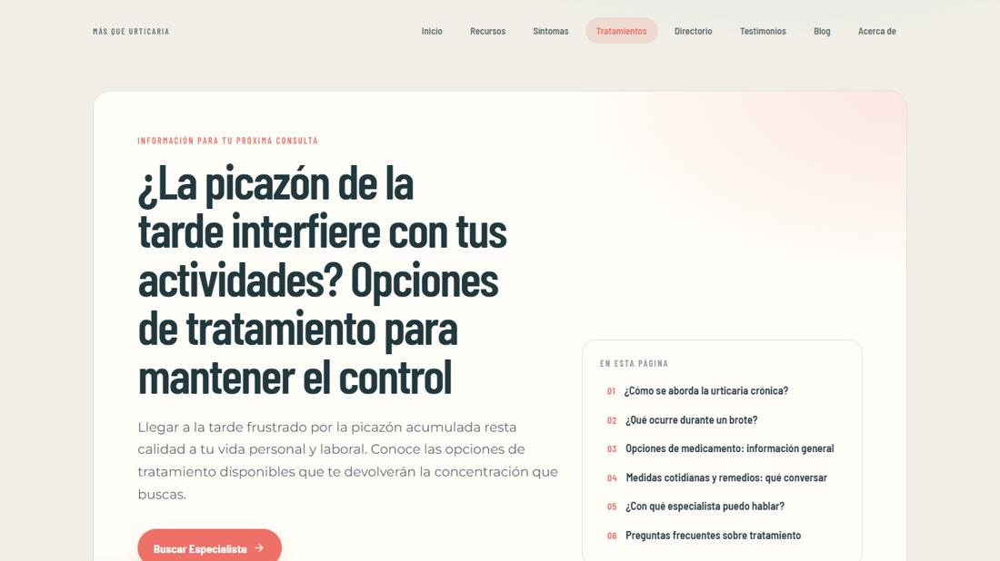

---

## Slide 24 · Tratamientos para la UCE (/tratamiento/): Captura 2 de 7

Slide en v2: 21 · Sección: Landings Informativas

**Comentario del cliente:**
- «Quitar el necesariamente»
- «Demasiado texto y misma info. No agrega valor.»

**Qué muestra la captura:** Sección 01 «¿Cómo se aborda la urticaria crónica?» (dice «no es necesariamente una alergia pasajera») y arranque de la 02 «¿Qué ocurre durante un brote?».

**Qué implica:** Sí. Quitar «necesariamente» y fusionar o eliminar la sección que repite el intro.  
**Veredicto:** Sí, aplicar

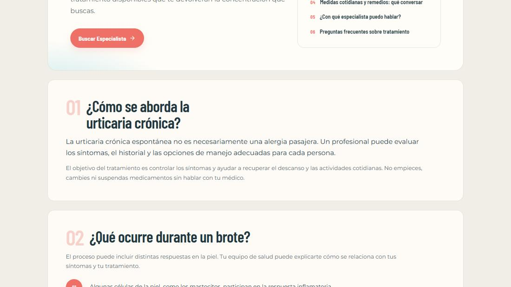

---

## Slide 25 · Tratamientos para la UCE (/tratamiento/): Captura 3 de 7

Slide en v2: 22 · Sección: Landings Informativas

**Comentario del cliente:**
- «Habones (ronchas), hichazón (angioedema)»
- «Corticoides??? / NO»
- «Esta sección me causa ruido, no está alineada a guías y no estamos diciendo nada, yo la quitaria.»

**Qué muestra la captura:** Sección 02 con 4 pasos (mastocitos, histamina, habones/hinchazón/comezón, el profesional determina el tratamiento) y sección 03 «Opciones de medicamento» con tarjetas Antihistamínicos, Corticoides, Otras opciones y Terapias dirigidas.

**Qué implica:** Eliminar la sección «Opciones de medicamento» y la FAQ de corticoides. Regla de redacción: nombre médico con el coloquial entre paréntesis.  
**Veredicto:** Sí, aplicar

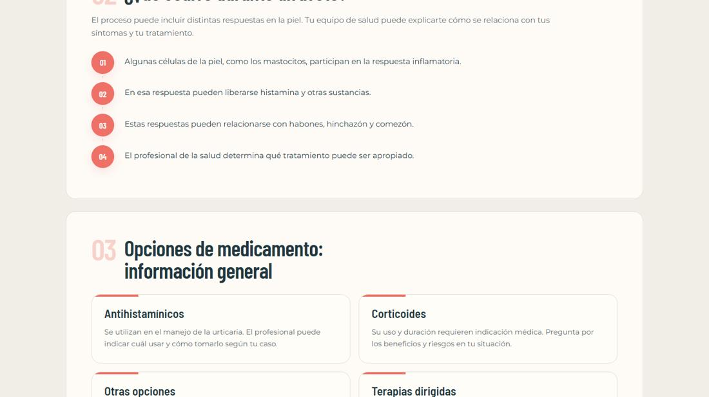

---

## Slide 26 · Tratamientos para la UCE (/tratamiento/): Captura 4 de 7

Slide en v2: 23 · Sección: Landings Informativas

**Comentario del cliente:**
- «Eliminar el cuadro de medicamentos sin receta o cremas»
- «Cambiar consulta a un professional por visita a tu medico y con link hacia el directorio»
- «Eliminar tópicos caseros»
- «Está sección suma??? Quiero inviter a medidas cotidianas? O a ir con su medico?»

**Qué muestra la captura:** Final de la sección 03 (Otras opciones, Terapias dirigidas) y sección 04 «Medidas cotidianas y remedios: qué conversar», tabla con compresas frías, ropa holgada, medicamentos sin receta o cremas y remedios tópicos caseros.

**Qué implica:** Sí a los tres cambios. Recomendación: eliminar la sección y dejar el llamado a visitar al médico con el botón al directorio.  
**Veredicto:** Sí, aplicar

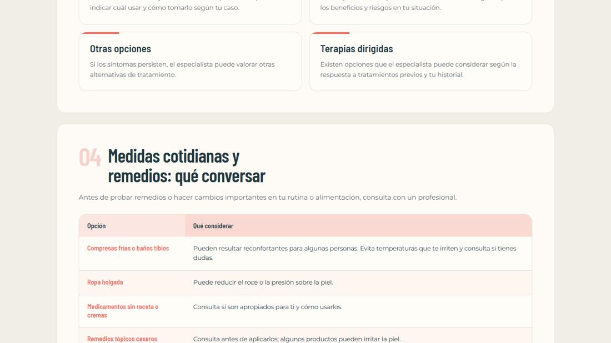

---

## Slide 27 · Tratamientos para la UCE (/tratamiento/): Captura 5 de 7

Slide en v2: 24 · Sección: Landings Informativas

**Comentario del cliente:**
- «Agregar el link a encuentra a un especialista cerca de tí, yo no podria el detalle de qué trata la especialidad / Las letras chiquitas ni se ven y ni agregan nada»

**Qué muestra la captura:** Fin de la tabla de remedios (dietas restrictivas) y sección 05 «¿Con qué especialista puedo hablar?» con tarjetas Dermatología y Alergología e inmunología. Empieza la sección 06.

**Qué implica:** Link directo y quitar el detalle de especialidades. Letras chiquitas: validar con Legal antes de quitarlas.  
**Veredicto:** Requiere decisión

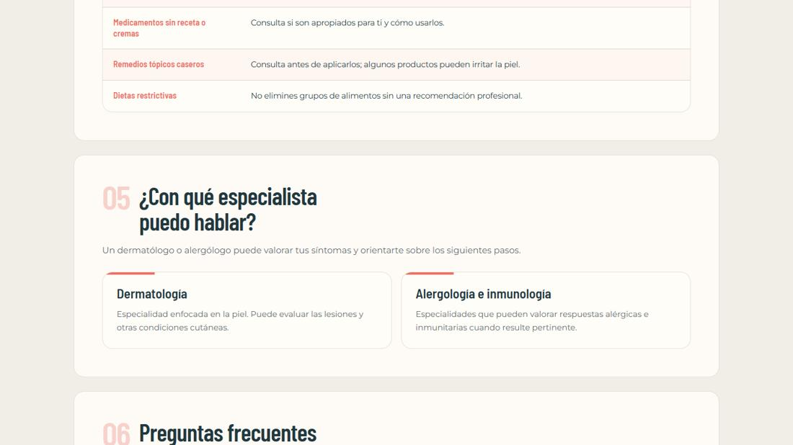

---

## Slide 28 · Tratamientos para la UCE (/tratamiento/): Captura 6 de 7

Slide en v2: 25 · Sección: Landings Informativas

**Comentario del cliente:**
- «Qué sale en el +? / Esta sección no me hace sentido»

**Qué muestra la captura:** Sección 06 «Preguntas frecuentes sobre tratamiento»: 3 acordeones cerrados (antihistamínicos sin consultar, cuánto tiempo tomar el medicamento, corticoides) y cierre «Da el siguiente paso con acompañamiento médico».

**Qué implica:** Al presionar «+» se despliega la respuesta. Sin la parte de medicamentos la sección queda vacía: eliminarla o reescribirla sobre cuándo ir al médico.  
**Veredicto:** Sí, aplicar

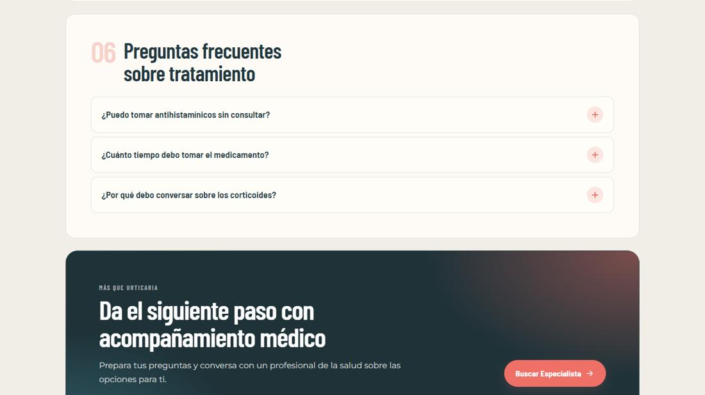

---

## Slide 29 · Tratamientos para la UCE (/tratamiento/): Captura 7 de 7

Slide en v2: 26 · Sección: Landings Informativas

**Comentario del cliente:**
- «Quitar las mini letras»

**Qué muestra la captura:** Cierre «Da el siguiente paso con acompañamiento médico» con botón «Buscar Especialista» y el pie de página con letras pequeñas.

**Qué implica:** Depende de Legal: si es aviso obligatorio no se quita.  
**Veredicto:** Requiere decisión

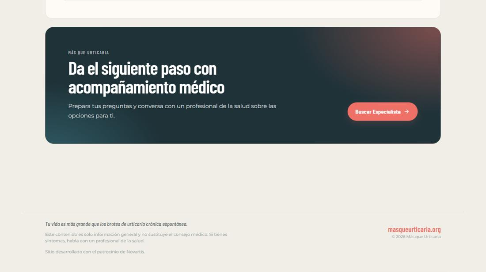

---

## Slide 30 · Sobre nosotros (/sobre-nosotros/): Captura 1 de 5

Slide en v2: 27 · Sección: Landings Informativas

**Comentario del cliente:**
- «Agregar leyenda en todas las recomendaciones de tratamientos farmacológicos: “Recuerda: Únicamente un profesional de la salud puede hacer un diagnóstico de esta enfermedad y sugerir un tratamiento específico.”»

**Qué muestra la captura:** Encabezado de Sobre nosotros: título «Sobre Nosotros: Más que Urticaria», índice de 4 secciones y botón «Conoce el sitio». Empieza «¿Quiénes somos?».

**Qué implica:** La captura es el encabezado de Sobre nosotros y no tiene recomendaciones. Parece comentario de Tratamientos. Confirmar con quien comentó; la leyenda sí se aplica como regla general.  
**Veredicto:** No aplica / sin sentido

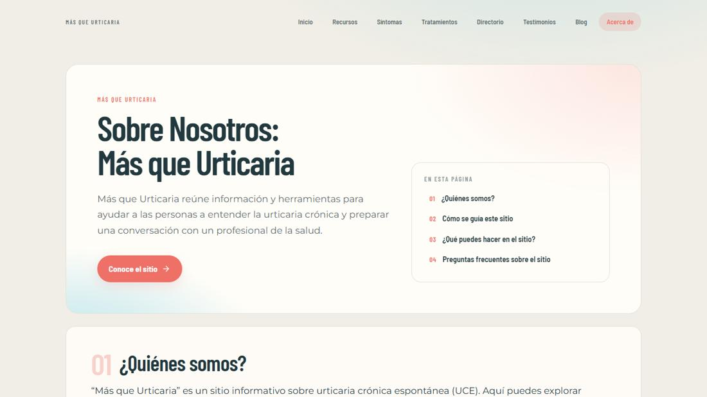

---

## Slide 31 · Sobre nosotros (/sobre-nosotros/): Captura 2 de 5

Slide en v2: 28 · Sección: Landings Informativas

**Comentario del cliente:**
- «Eliminar el mensaje “Este sitio es desarrollado con el patrocinio de Novartis” ya que la leyenda aparecera en el pie del sitio web.»
- «Hacerlo más creativo, reducir texto,»

**Qué muestra la captura:** Sección 01 «¿Quiénes somos?» (incluye «Este sitio es desarrollado con el patrocinio de Novartis») y sección 02 «Cómo se guía este sitio» con principios de contenido.

**Qué implica:** Sí, una vez que el pie lleve la leyenda aprobada. Condensar con tarjetas visuales.  
**Veredicto:** Sí, aplicar

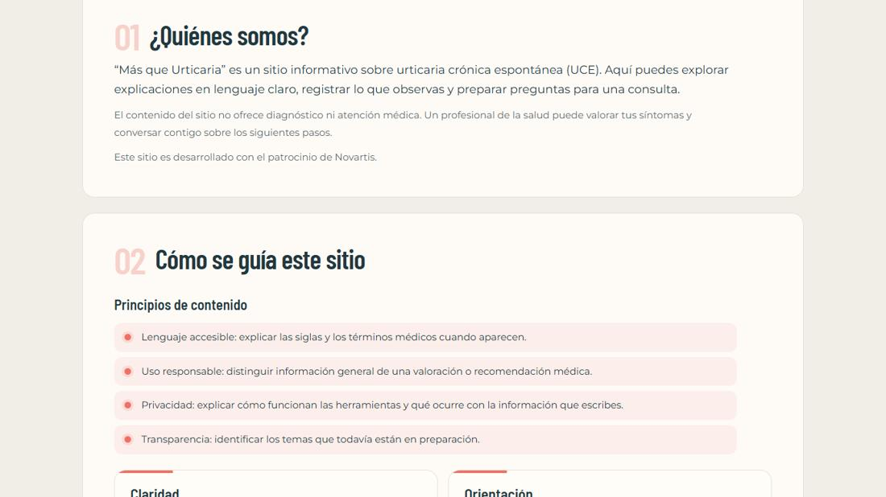

---

## Slide 32 · Sobre nosotros (/sobre-nosotros/): Captura 3 de 5

Slide en v2: 29 · Sección: Landings Informativas

**Comentario del cliente:**
- «Agregar leyenda en todas las recomendaciones de tratamientos farmacológicos: “Recuerda: Únicamente un profesional de la salud puede hacer un diagnóstico de esta enfermedad y sugerir un tratamiento específico.”»
- «En vez de entender, mostrar los sintomas con imagenes y nombres debajo de las imagenes. Incluir referencias Estilo IEE.»
- «Tener el link directo al “Encuentra a tu especialista”. En vez de explicar más.»

**Qué muestra la captura:** Fin de la sección 02 (Claridad, Orientación) y sección 03 «¿Qué puedes hacer en el sitio?» con 3 tarjetas: Entender los síntomas, Preparar la consulta, Conocer opciones generales.

**Qué implica:** Leyenda e imágenes no aplican a esta pantalla (parecen de otra página). El link directo al directorio sí.  
**Veredicto:** No aplica / sin sentido

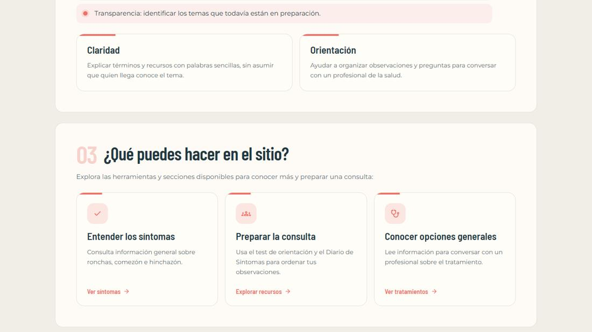

---

## Slide 33 · Sobre nosotros (/sobre-nosotros/): Captura 4 de 5

Slide en v2: 30 · Sección: Landings Informativas

**Comentario del cliente:**
- «Estamos recomendando que opciones tomar? Es mejor redireccionar al Visite a un medico.»
- «Es recommendable ponerlo como pregunta? Seríía mejor un claim génerico en vez de aumentar el texto»

**Qué muestra la captura:** Sección 04 «Preguntas frecuentes sobre el sitio» (2 acordeones: consultas médicas directas, costo) y cierre «Recuerda: tu vida es más que urticaria».

**Qué implica:** Sí. Un claim breve y botón al directorio.  
**Veredicto:** Sí, aplicar

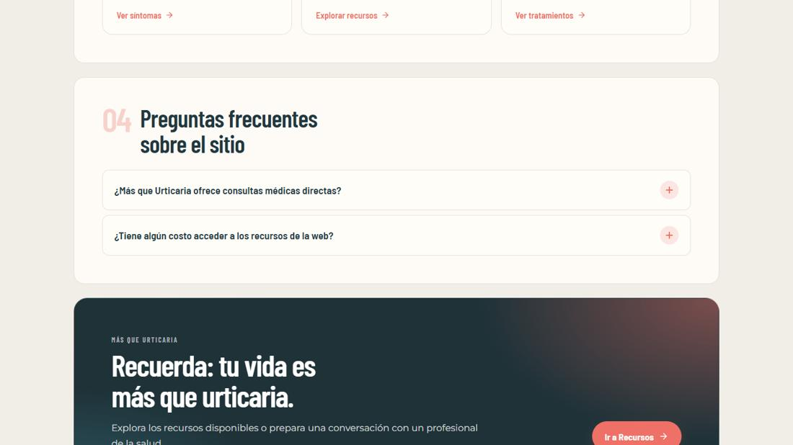

---

## Slide 34 · Divisoria · Sección 03 Recursos y herramientas

Slide en v2: 31 · Sección 03

**Comentario del cliente:** sin comentarios.

---

## Slide 35 · Hub de Recursos y Herramientas (/recursos-herramientas/): Captura 1 de 5

Slide en v2: 32 · Sección: Recursos Y Herramientas

**Comentario del cliente:**
- «En vez de ocupar recursos utilizar un wording más para el apoyo al paciente, “Vivir con Urticaria es escucharte y anotar tus síntomas diarios”»
- «Promover el uso de herramientas como UAS7 y UCT, conectado al test de orientación. / Hacerlo creativo, fácil y rápido.»

**Qué muestra la captura:** Inicio de Recursos: título «Recursos para entender y registrar tus síntomas» y arranque de la sección 01 «¿Por dónde quieres empezar?».

**Qué implica:** Sí. Reescribir el encabezado y conectar el hub con el test. Validar la escala con el equipo médico.  
**Veredicto:** Sí, aplicar

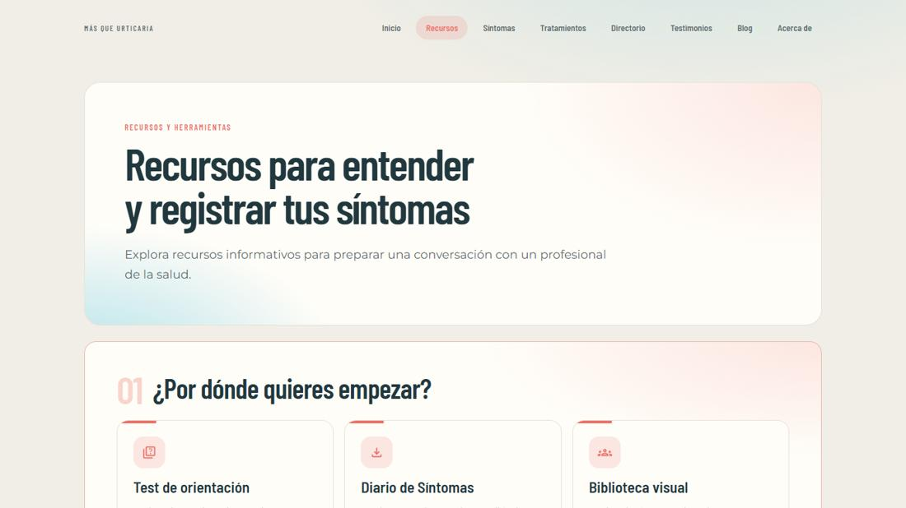

---

## Slide 36 · Hub de Recursos y Herramientas (/recursos-herramientas/): Captura 2 de 5

Slide en v2: 33 · Sección: Recursos Y Herramientas

**Comentario del cliente:**
- «Promover el uso de herramientas como UAS7 y UCT, conectado al test de orientación. / Hacerlo creativo, fácil y rápido.»

**Qué muestra la captura:** Tarjetas Test de orientación, Diario de Síntomas y Biblioteca visual, y arranque de la «Biblioteca de fotos por tono de piel» con filtros por tono.

**Qué implica:** Igual que slide 35.  
**Veredicto:** Sí, aplicar

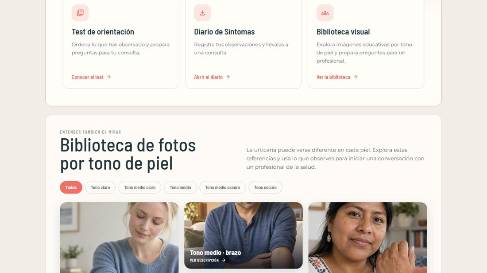

---

## Slide 37 · Hub de Recursos y Herramientas (/recursos-herramientas/): Captura 3 de 5

Slide en v2: 34 · Sección: Recursos Y Herramientas

**Comentario del cliente:**
- «La UCE no solamente son ronchas, se puede confundir con otros síntomas. / Marcar mucho la definición de la UCE con los síntomas de ella: Ronchas, comezon, hinchazon o angiedema, sensación de ardor. / Remarcar el tiempo que se presentan los síntomas 6 Semanas o más. Esto es clave para la idenficación de la UCE.»

**Qué muestra la captura:** Galería de fotos por tono de piel (claro, medio claro, medio, oscuro) con personas mostrando brazo, hombro, mano. Cada foto tiene etiqueta y «Ver descripción».

**Qué implica:** Sí. Definición destacada con esos cuatro síntomas y las 6 semanas. «Ardor» hoy no está.  
**Veredicto:** Sí, aplicar

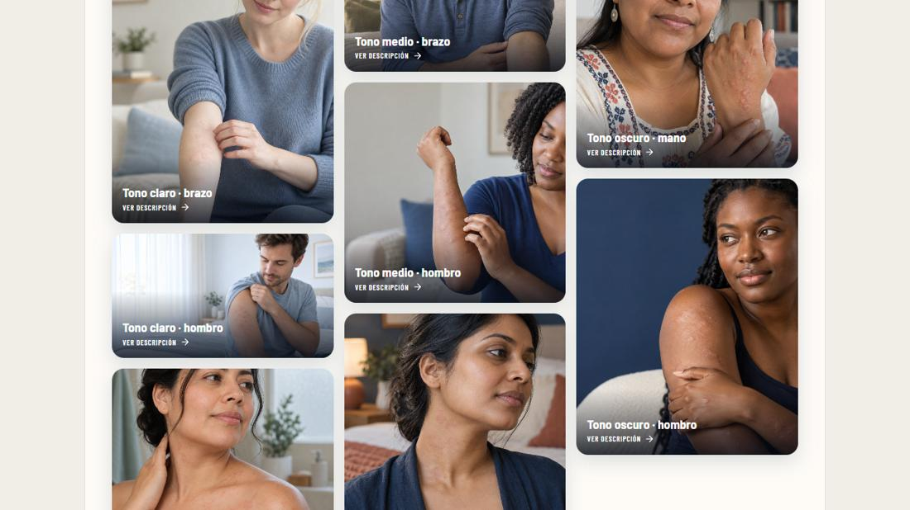

---

## Slide 38 · Biblioteca visual: Imagen ampliada

Slide en v2: 35 · Sección: Recursos Y Herramientas

**Comentario del cliente:**
- «Agregar todos los síntomas de la UCE, la UCE no solamente son ronchas.»

**Qué muestra la captura:** Foto ampliada de la biblioteca: «Tono claro · brazo», con la descripción «Referencia visual de cambios sutiles en el brazo sobre un tono de piel claro».

**Qué implica:** Agregar angioedema y ardor a la biblioteca.  
**Veredicto:** Sí, aplicar

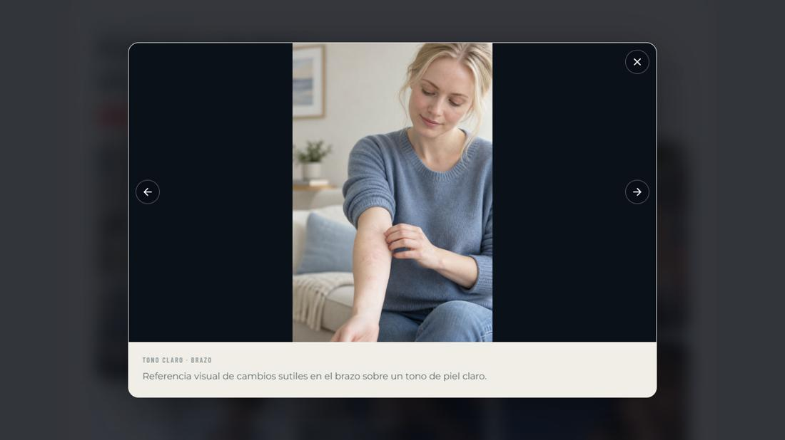

---

## Slide 39 · Diario de Síntomas (/diario/): Captura 1 de 6

Slide en v2: 36 · Sección: Recursos Y Herramientas

**Comentario del cliente:**
- «Jugaría en como enseñar a registrar ronchas e hinchazón con la calculadora UAS7 o UCT. / El diario esta bien pero considerar que se debe de facilitar el acceso 24/7 no solamente cuando tenga Wifi.»

**Qué muestra la captura:** Inicio del Diario: título «Diario de Síntomas: Registra tus Brotes y Toma el Control», botones «Usar el diario» e «Imprimir o guardar como PDF», y arranque de «Mi Diario de Síntomas».

**Qué implica:** Sí. Incorporar el conteo UAS7 al diario con una guía visual.  
**Veredicto:** Sí, aplicar

**Qué implica:** Es un sitio web: necesita conexión para abrir. Ya está disponible las 24 h. Solo aplicaría con app o PWA. La reunión sí pide guardado local; ver el pendiente de diario.  
**Veredicto:** No aplica / sin sentido

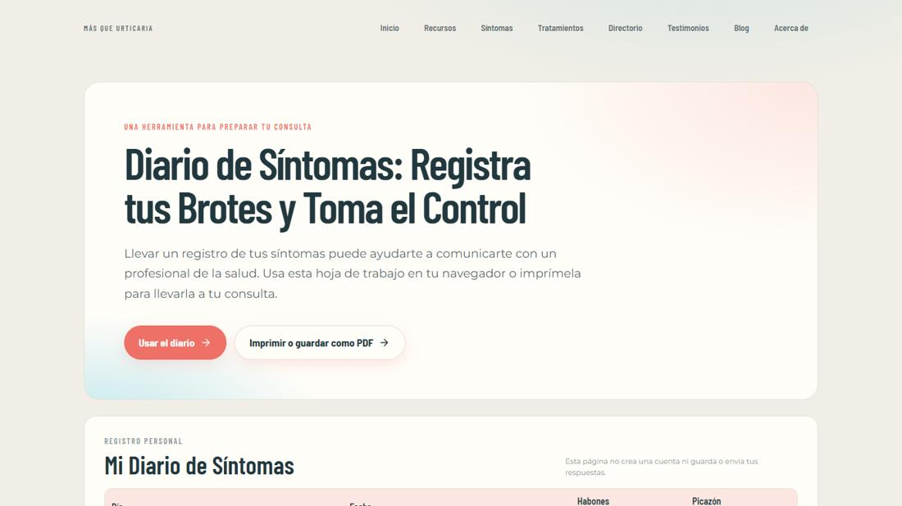

---

## Slide 40 · Diario de Síntomas (/diario/): Captura 2 de 6

Slide en v2: 37 · Sección: Recursos Y Herramientas

**Comentario del cliente:** sin comentarios.

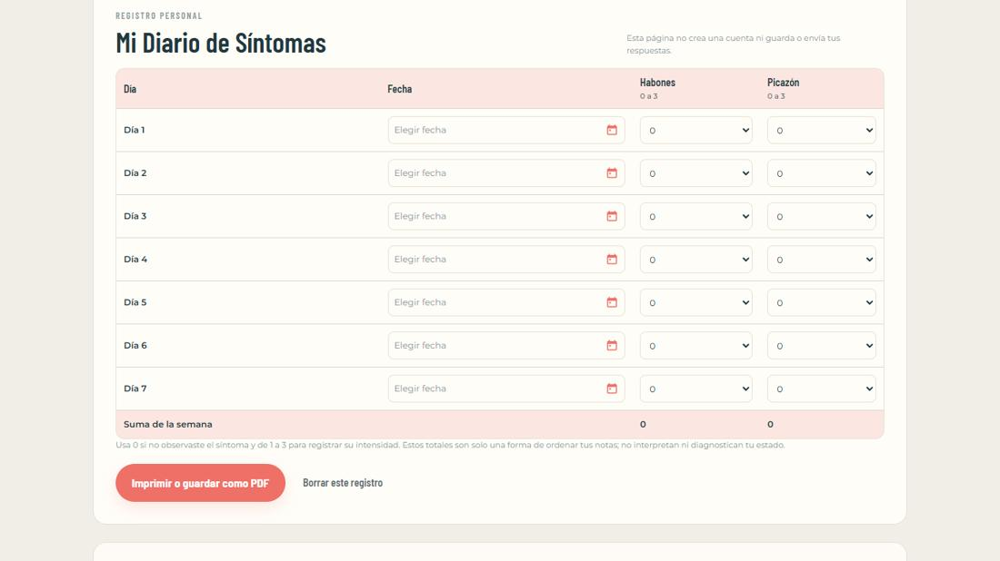

---

## Slide 41 · Diario de Síntomas (/diario/): Captura 3 de 6

Slide en v2: 38 · Sección: Recursos Y Herramientas

**Comentario del cliente:**
- «Jugaría en como enseñar a registrar ronchas e hinchazón con la calculadora UAS7 o UCT. / El diario esta bien pero considerar que se debe de facilitar el acceso 24/7 no solamente cuando tenga Wifi.»

**Qué muestra la captura:** Secciones 01 «¿Qué es el Diario de Síntomas y cómo te ayuda?» y 02 «¿Cómo evaluar tus síntomas día a día?» (escala de 0 a 3, texto con «picazón»).

**Qué implica:** Sí. Incorporar el conteo UAS7 al diario con una guía visual.  
**Veredicto:** Sí, aplicar

**Qué implica:** Es un sitio web: necesita conexión para abrir. Ya está disponible las 24 h. Solo aplicaría con app o PWA. La reunión sí pide guardado local; ver el pendiente de diario.  
**Veredicto:** No aplica / sin sentido

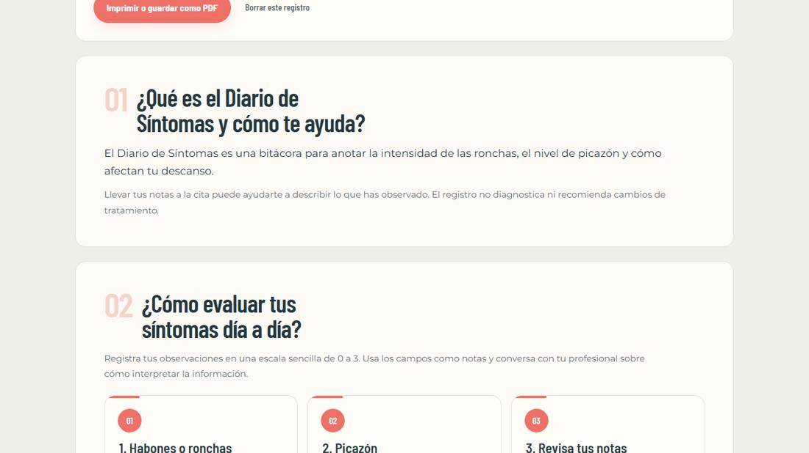

---

## Slide 42 · Diario de Síntomas (/diario/): Captura 4 de 6

Slide en v2: 39 · Sección: Recursos Y Herramientas

**Comentario del cliente:**
- «Utilizar imagenes para ejemplso de habones o ronchas,1.Ej. Cuantas ronchas como estas tienes en el cuerpo? FOTO / 2. Hinchazon o angioedema: cuantas veces has tenido este síntoma en las 6 Semanas? FOTO / 3.ANOTA: Utiliza esta guía para / Ser más visual, no por texto. El texto pierde al paciente, las imagenes no.»

**Qué muestra la captura:** Tarjetas 1 Habones o ronchas, 2 Picazón, 3 Revisa tus notas, y sección 03 «Preguntas frecuentes sobre el Diario» (3 acordeones). Solo texto.

**Qué implica:** Sí. Mismo banco de imágenes que en Síntomas. Cuidar que no sean de IA.  
**Veredicto:** Sí, aplicar

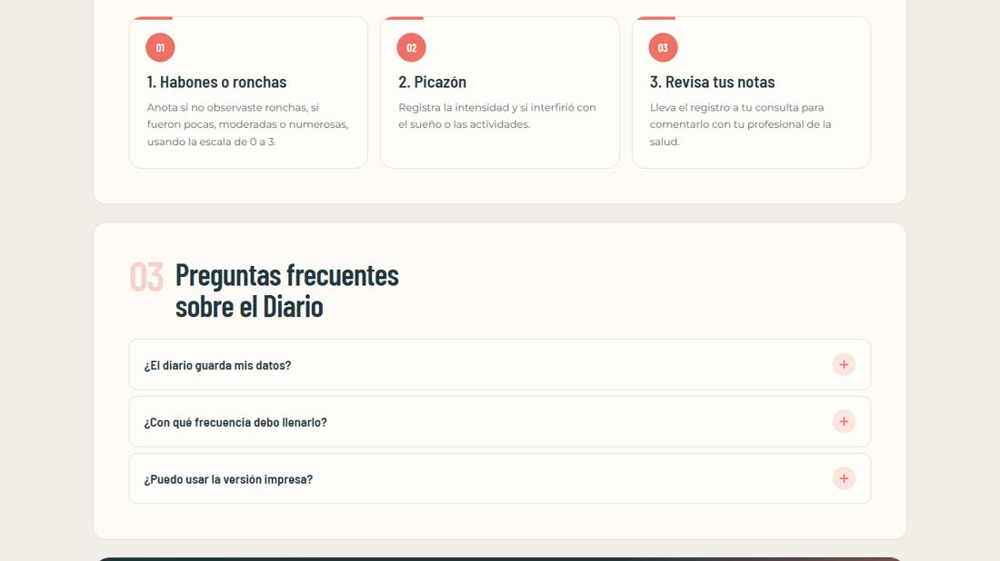

---

## Slide 43 · Diario de Síntomas (/diario/): Captura 5 de 6

Slide en v2: 40 · Sección: Recursos Y Herramientas

**Comentario del cliente:** sin comentarios.

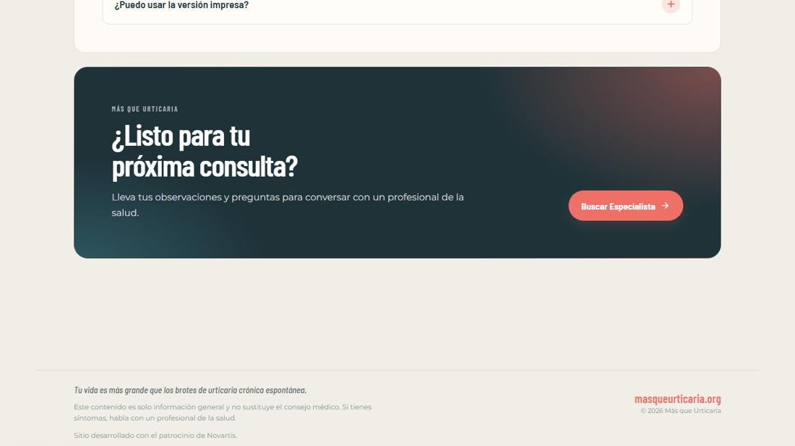

---

## Slide 44 · Diario: Selector de fecha

Slide en v2: 41 · Sección: Recursos Y Herramientas

**Comentario del cliente:**
- «Jugaría en como enseñar a registrar ronchas e hinchazón con la calculadora UAS7 o UCT. / El diario esta bien pero considerar que se debe de facilitar el acceso 24/7 no solamente cuando tenga Wifi.»

**Qué muestra la captura:** Tabla de 7 días del diario con el selector de fecha abierto (calendario de octubre de 2026). Columnas Habones y Picazón de 0 a 3.

**Qué implica:** Sí. Incorporar el conteo UAS7 al diario con una guía visual.  
**Veredicto:** Sí, aplicar

**Qué implica:** Es un sitio web: necesita conexión para abrir. Ya está disponible las 24 h. Solo aplicaría con app o PWA. La reunión sí pide guardado local; ver el pendiente de diario.  
**Veredicto:** No aplica / sin sentido

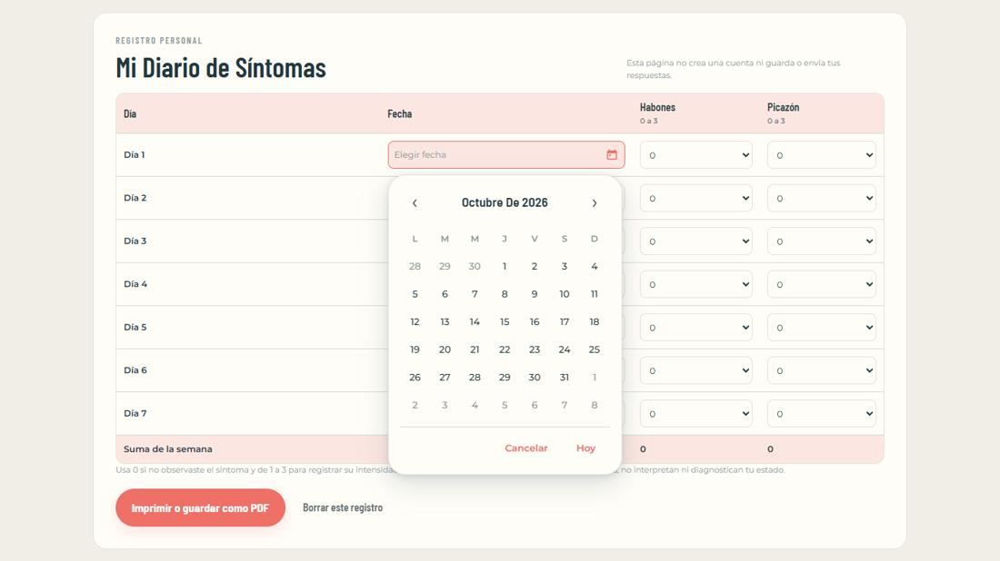

---

## Slide 45 · Diario: Registro con datos de ejemplo y totales

Slide en v2: 42 · Sección: Recursos Y Herramientas

**Comentario del cliente:**
- «Jugaría en como enseñar a registrar ronchas e hinchazón con la calculadora UAS7 o UCT. / El diario esta bien pero considerar que se debe de facilitar el acceso 24/7 no solamente cuando tenga Wifi.»

**Qué muestra la captura:** Tabla del diario con un registro de ejemplo (día 1 del 13 oct 2026, habones 2, picazón 3) y totales de la semana.

**Qué implica:** Sí. Incorporar el conteo UAS7 al diario con una guía visual.  
**Veredicto:** Sí, aplicar

**Qué implica:** Es un sitio web: necesita conexión para abrir. Ya está disponible las 24 h. Solo aplicaría con app o PWA. La reunión sí pide guardado local; ver el pendiente de diario.  
**Veredicto:** No aplica / sin sentido

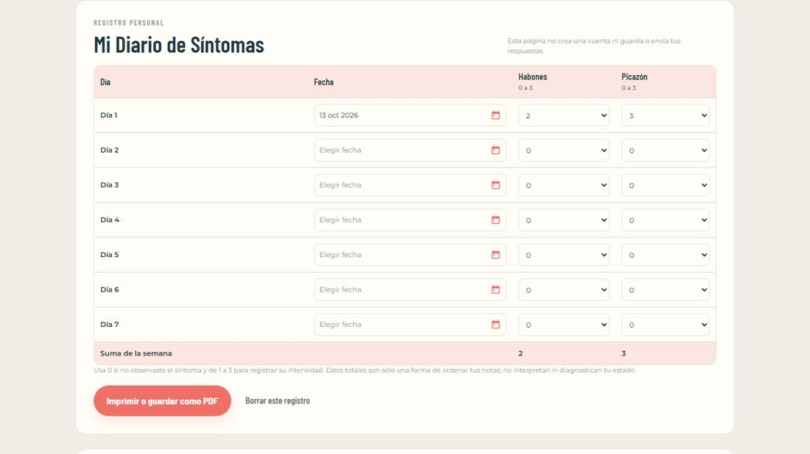

---

## Slide 46 · Testimonios y comunidad (/testimonios/): Captura 1 de 6

Slide en v2: 43 · Sección: Recursos Y Herramientas

**Comentario del cliente:**
- «Jugar con la frase Historias reales, con “No eres el único que confundieron una alergia con UCE” agregar el mito + complementar el mensaje que no eres el único.»

**Qué muestra la captura:** Inicio de Testimonios: título «Historias Reales de Urticaria Crónica Espontánea: No Estás Solo», texto sobre resiliencia y botón «Compartir mi Historia».

**Qué implica:** Sí. Escribir el titular con el mito y con «urticaria crónica espontánea» completo.  
**Veredicto:** Sí, aplicar

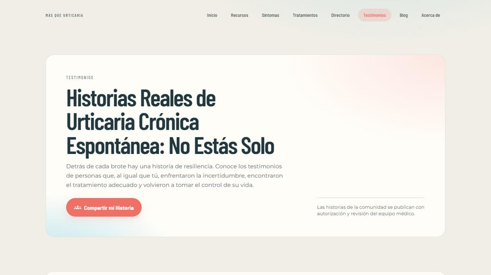

---

## Slide 47 · Testimonios y comunidad (/testimonios/): Captura 2 de 6

Slide en v2: 44 · Sección: Recursos Y Herramientas

**Comentario del cliente:** sin comentarios.

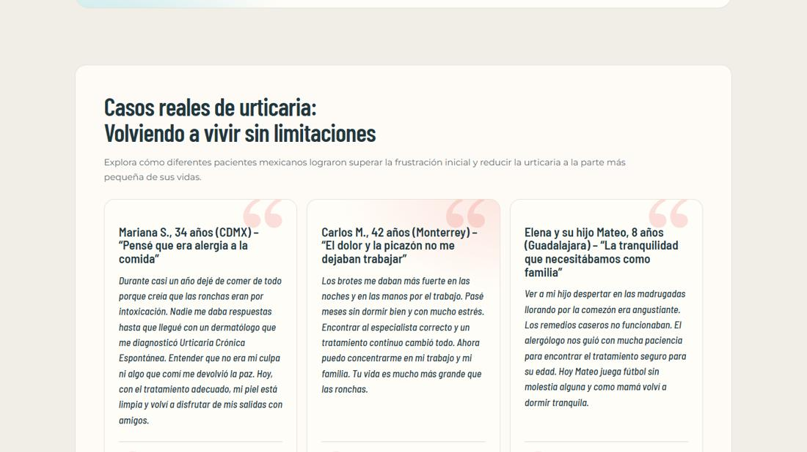

---

## Slide 48 · SECCIÓN: RECURSOS Y HERRAMIENTASTestimonios y comunidad (/testimonios/): Captura 3 de 6

Slide en v2: 45 · Sección: Recursos Y HerramientasTestimonios Y Comunidad (/Testimonios/): Captura 3 De 6

**Comentario del cliente:**
- «Si se puede encontrar, agregar data de prevalencia e incidencia. Jugando con burbujas.»

**Qué muestra la captura:** Tres casos con nombre, edad y ciudad (Mariana S., 34 años, CDMX; Carlos M., 42, Monterrey; Elena y su hijo Mateo, 8, Guadalajara) y la sección «Historias compartidas por la comunidad».

**Qué implica:** Solo si hay dato citable (Medical Affairs). Se aceptan burbujas.  
**Veredicto:** Requiere decisión

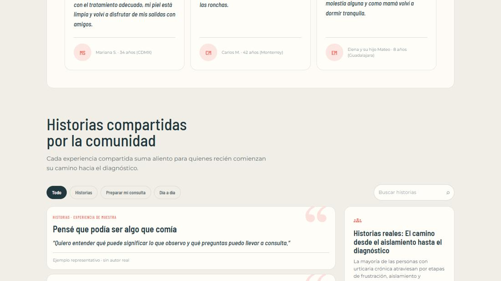

---

## Slide 49 · Testimonios y comunidad (/testimonios/): Captura 4 de 6

Slide en v2: 46 · Sección: Recursos Y Herramientas

**Comentario del cliente:** sin comentarios.

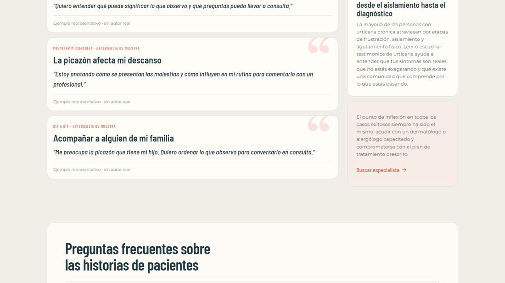

---

## Slide 50 · Testimonios y comunidad (/testimonios/): Captura 5 de 6

Slide en v2: 47 · Sección: Recursos Y Herramientas

**Comentario del cliente:**
- «En vez de dar recomendación con el contacto con un especialista, redireccionar directamente a la búsqueda de tu medico.»
- «Todos los testimonios son anónimos»

**Qué muestra la captura:** Sección «Preguntas frecuentes sobre las historias de pacientes» (2 acordeones: compartir de forma anónima, contacto con un especialista) y cierre «¿Quieres compartir cómo hiciste a la urticaria más pequeña en tu vida?».

**Qué implica:** Sí. Botón directo al directorio y aviso visible de anonimato.  
**Veredicto:** Sí, aplicar

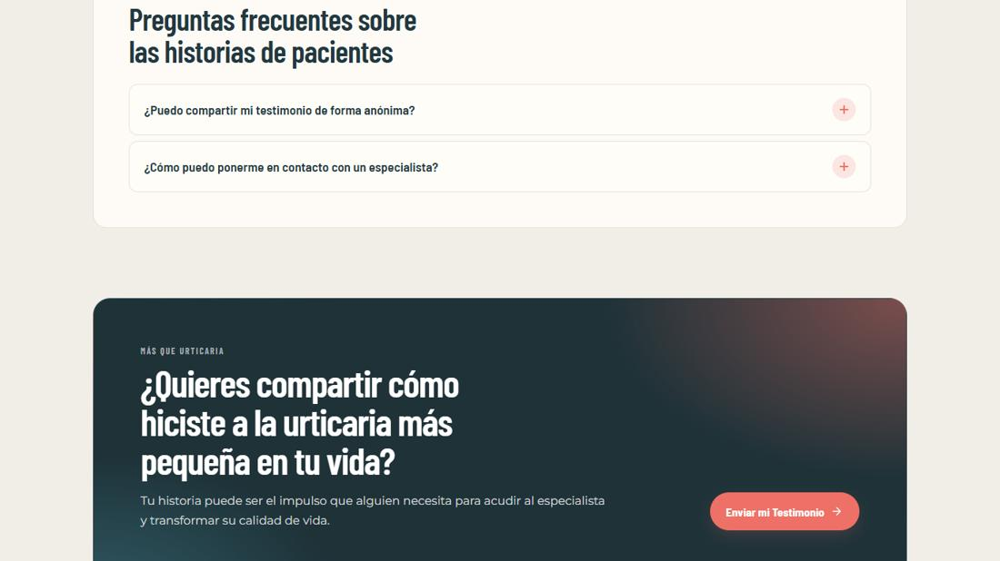

---

## Slide 51 · Testimonios: Formulario para compartir de forma anónima

Slide en v2: 48 · Sección: Recursos Y Herramientas

**Comentario del cliente:** sin comentarios.

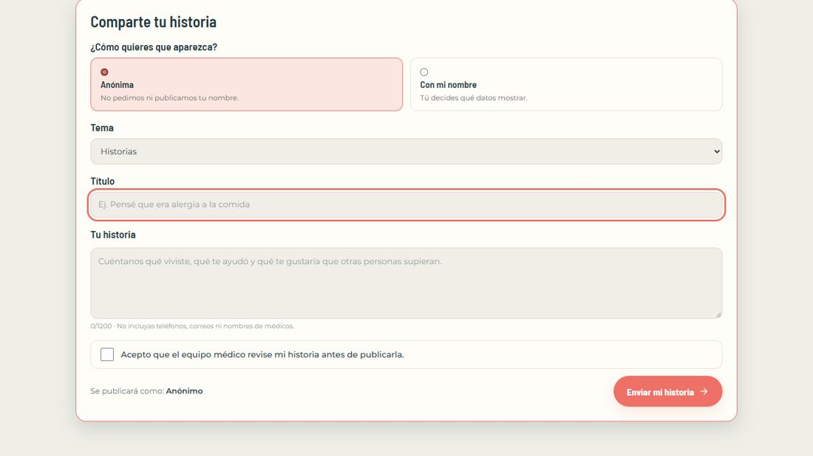

---

## Slide 52 · SECCIÓN: RECURSOS Y HERRAMIENTASTestimonios: Formulario con nombre opcional

Slide en v2: 49 · Sección: Recursos Y HerramientasTestimonios: Formulario Con Nombre Opcional

**Comentario del cliente:** sin comentarios.

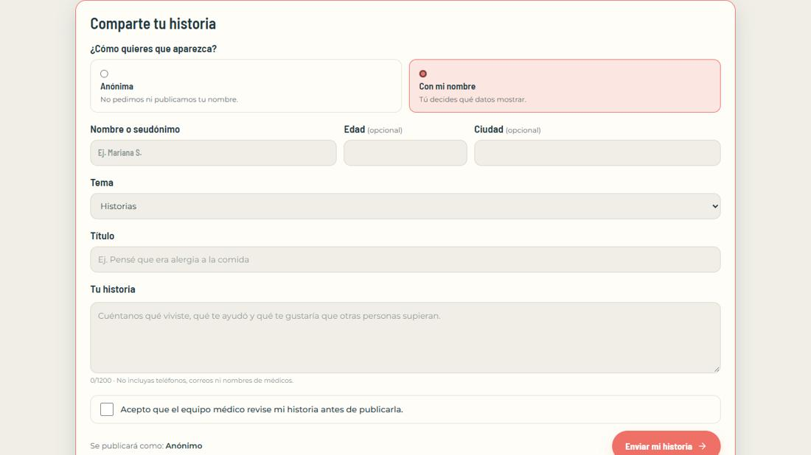

---

## Slide 53 · Testimonios: Consentimiento y envío de historia de ejemplo

Slide en v2: 50 · Sección: Recursos Y Herramientas

**Comentario del cliente:** sin comentarios.

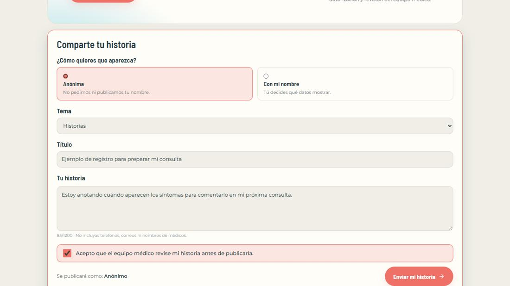

---

## Slide 54 · Testimonios: Confirmación del registro en el prototipo

Slide en v2: 51 · Sección: Recursos Y Herramientas

**Comentario del cliente:** sin comentarios.

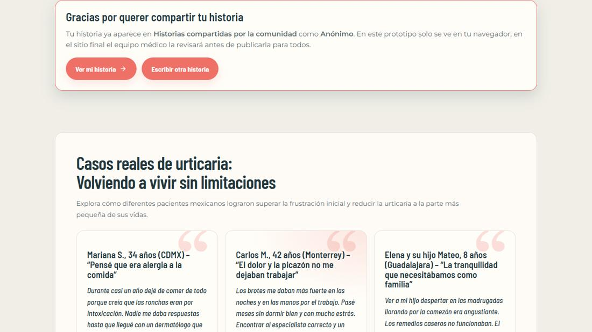

---

## Slide 55 · Divisoria · Sección 04 Quiz orientativo

Slide en v2: 52 · Sección 04

**Comentario del cliente:** sin comentarios.

---

## Slide 56 · Q0: Nombre opcional

Slide en v2: 53 · Sección: Quiz Orientativo

**Comentario del cliente:** sin comentarios.

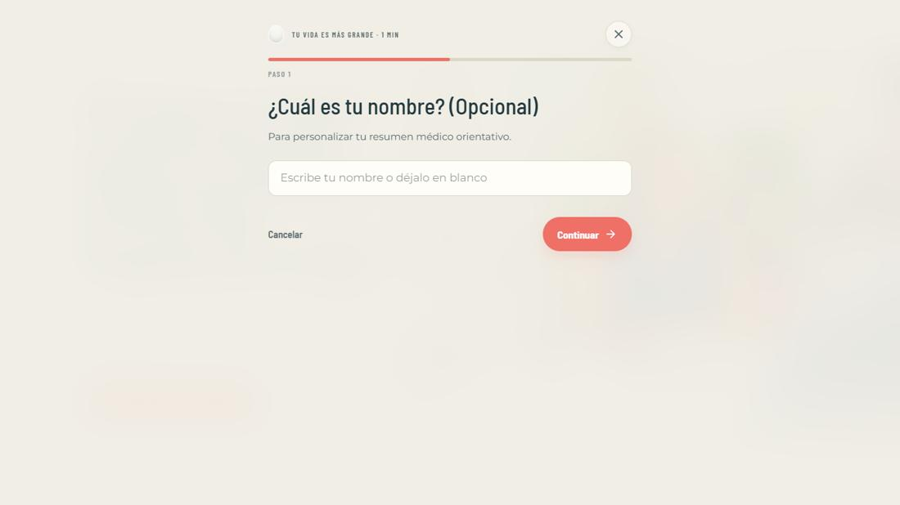

---

## Slide 57 · Q1: Síntomas presentados (selección múltiple)

Slide en v2: 54 · Sección: Quiz Orientativo

**Comentario del cliente:**
- «Agregar imagenes»

**Qué muestra la captura:** Quiz, paso 2 (Q1): «¿Has presentado alguno de los siguientes síntomas?» con 4 opciones de selección múltiple (Ninguno, Ronchas, Comezón intensa, Hinchazón). Sin imágenes.

**Qué implica:** Sí, con revisión médica: Q1b es el descarte de urgencia y una imagen mal elegida puede confundir.  
**Veredicto:** Sí, aplicar

---

## Slide 58 · Q1b: Descarte de urgencia (solo si hay hinchazón)

Slide en v2: 55 · Sección: Quiz Orientativo

**Comentario del cliente:**
- «Agregar imagenes»

**Qué muestra la captura:** Quiz, paso 3 (Q1b): «¿La hinchazón es en labios, lengua o garganta, o te cuesta respirar?» con opciones Sí / No. Es el descarte de urgencia. Sin imágenes.

**Qué implica:** Sí, con revisión médica: Q1b es el descarte de urgencia y una imagen mal elegida puede confundir.  
**Veredicto:** Sí, aplicar

---

## Slide 59 · Urgencia: Interrupción del cuestionario y llamada al 911

Slide en v2: 56 · Sección: Quiz Orientativo

**Comentario del cliente:** sin comentarios.

---

## Slide 60 · Q2: Tiempo con síntomas

Slide en v2: 57 · Sección: Quiz Orientativo

**Comentario del cliente:**
- «Agregar apartado un cuadro por Semanas, la UCE se identifica cuando se presenta durante 6 Semanas o más.»

**Qué muestra la captura:** Quiz, paso 4 (Q2): «¿Cuánto tiempo llevas con estos síntomas?». Opciones: menos de 1 semana, de 1 semana a 1 mes, de 1 mes a 6 meses, más de 6 meses.

**Qué implica:** Sí. Selector por semanas con la marca de 6 semanas.  
**Veredicto:** Sí, aplicar

---

## Slide 61 · Q3: Cantidad de ronchas (si Q1 incluye ronchas)

Slide en v2: 58 · Sección: Quiz Orientativo

**Comentario del cliente:**
- «Ponerlo con escala jugando la calculadora UAS7. Utilizar un gráfico de más o menos con base a la calculadora y que ellos puedan dejar la flecha en el número de ronchas y en el color. Adjunto ej.»

**Qué muestra la captura:** Quiz, paso 5 (Q3): cantidad de ronchas en la última semana. Opciones: Ninguna, Leve (menos de 20), Moderada (20 a 50), Alta (más de 50). Son tarjetas de texto.

**Qué implica:** Sí, es un rediseño: hay que ver el ejemplo adjunto (no venía en la PPT) y revalidar el score con el equipo médico.  
**Veredicto:** Requiere decisión

---

## Slide 62 · Q4: Intensidad de comezón (si Q1 incluye comezón)

Slide en v2: 59 · Sección: Quiz Orientativo

**Comentario del cliente:**
- «Ponerlo con escala jugando la calculadora UAS7. Utilizar un gráfico de más o menos con base a la calculadora y que ellos puedan dejar la flecha en el número de ronchas y en el color. Adjunto ej.»

**Qué muestra la captura:** Quiz, paso 6 (Q4): intensidad de la comezón. Opciones: Ninguna, Leve, Moderada, Alta / Severa.

**Qué implica:** Sí, es un rediseño: hay que ver el ejemplo adjunto (no venía en la PPT) y revalidar el score con el equipo médico.  
**Veredicto:** Requiere decisión

---

## Slide 63 · Q5: Severidad de hinchazón (si Q1 incluye hinchazón)

Slide en v2: 60 · Sección: Quiz Orientativo

**Comentario del cliente:**
- «Ponerlo con escala jugando la calculadora UAS7. Utilizar un gráfico de más o menos con base a la calculadora y que ellos puedan dejar la flecha en el número de ronchas y en el color. Adjunto ej.»

**Qué muestra la captura:** Quiz, paso 7 (Q5): severidad de la hinchazón. Opciones: Ninguna, Leve, Moderada, Intensa.

**Qué implica:** Sí, es un rediseño: hay que ver el ejemplo adjunto (no venía en la PPT) y revalidar el score con el equipo médico.  
**Veredicto:** Requiere decisión

---

## Slide 64 · Q6: Áreas de vida afectadas (selección múltiple)

Slide en v2: 61 · Sección: Quiz Orientativo

**Comentario del cliente:** sin comentarios.

---

## Slide 65 · Q7: Actividades diarias (si se seleccionó en Q6)

Slide en v2: 62 · Sección: Quiz Orientativo

**Comentario del cliente:**
- «Agregar una escala de “¿cuál de tus actiivdades diarias han sido afectadas? / Basarnos en escala  tipo calculadora UAS7, temenos que entrenar al paciente a que sepa utilizar esta herramienta.»

**Qué muestra la captura:** Quiz, paso 9 (Q7): «¿qué tanto han interferido los síntomas con tus actividades diarias?». Opciones: Nada, Un poco, Medianamente, Mucho.

**Qué implica:** Sí, con un componente único y reutilizable para no alargar el quiz. Validar con el equipo médico.  
**Veredicto:** Requiere decisión

---

## Slide 66 · Q8: Relaciones familiares y sociales (si se seleccionó en Q6)

Slide en v2: 63 · Sección: Quiz Orientativo

**Comentario del cliente:**
- «Basarnos en que puedan responder en escala  tipo calculadora UAS7, temenos que entrenar al paciente a que sepa utilizar esta herramienta.»

**Qué muestra la captura:** Quiz, paso 10 (Q8): efecto en relaciones familiares, sociales o de pareja. Mismas 4 opciones (Nada a Mucho).

**Qué implica:** Sí, con un componente único y reutilizable para no alargar el quiz. Validar con el equipo médico.  
**Veredicto:** Requiere decisión

---

## Slide 67 · Q8b: Vida sexual (si se seleccionó en Q6)

Slide en v2: 64 · Sección: Quiz Orientativo

**Comentario del cliente:**
- «Basarnos en que puedan responder en escala  tipo calculadora UAS7, temenos que entrenar al paciente a que sepa utilizar esta herramienta.»

**Qué muestra la captura:** Quiz, paso 11 (Q8b): efecto en la vida sexual. Mismas 4 opciones.

**Qué implica:** Sí, con un componente único y reutilizable para no alargar el quiz. Validar con el equipo médico.  
**Veredicto:** Requiere decisión

---

## Slide 68 · Q9: Vestimenta (si se seleccionó en Q6)

Slide en v2: 65 · Sección: Quiz Orientativo · Vista 74 De 124

**Comentario del cliente:**
- «Basarnos en que puedan responder en escala  tipo calculadora UAS7, temenos que entrenar al paciente a que sepa utilizar esta herramienta.»

**Qué muestra la captura:** Quiz, paso 12 (Q9): cuánto condicionan los síntomas la ropa que usas. Mismas 4 opciones.

**Qué implica:** Sí, con un componente único y reutilizable para no alargar el quiz. Validar con el equipo médico.  
**Veredicto:** Requiere decisión

---

## Slide 69 · Q10: Trabajo o estudios (si se seleccionó en Q6)

Slide en v2: 66 · Sección: Quiz Orientativo

**Comentario del cliente:**
- «Basarnos en que puedan responder en escala  tipo calculadora UAS7, temenos que entrenar al paciente a que sepa utilizar esta herramienta.»

**Qué muestra la captura:** Quiz, paso 13 (Q10): efecto en el trabajo o estudios. Mismas 4 opciones.

**Qué implica:** Sí, con un componente único y reutilizable para no alargar el quiz. Validar con el equipo médico.  
**Veredicto:** Requiere decisión

---

## Slide 70 · Q11: Sueño (si se seleccionó en Q6)

Slide en v2: 67 · Sección: Quiz Orientativo

**Comentario del cliente:**
- «Basarnos en que puedan responder en escala  tipo calculadora UAS7, temenos que entrenar al paciente a que sepa utilizar esta herramienta.»

**Qué muestra la captura:** Quiz, paso 14 (Q11): efecto en la calidad de sueño. Mismas 4 opciones.

**Qué implica:** Sí, con un componente único y reutilizable para no alargar el quiz. Validar con el equipo médico.  
**Veredicto:** Requiere decisión

---

## Slide 71 · Q12: Posibles desencadenantes (selección múltiple)

Slide en v2: 68 · Sección: Quiz Orientativo

**Comentario del cliente:**
- «en la UCE no existen descadenantes podemos jugar con la sig pregunta “cuando te salen ronchas, cual de estos comentarios has recibido? / -Estrés / -Alergía / -Sudor / -Clima / -Etc / Mitos que escuchan diariamente los px con UCE»

**Qué muestra la captura:** Quiz, paso 15 (Q12): «¿Consideras que alguno de estos eventos desencadena o intensifica tus síntomas?». Opciones: clima caliente, sol o duchas calientes; clima frío, aire helado o agua fría; estrés emocional o tensión; sudor o ejercicio físico; ropa ajustada o roce; no identifico ningún detonante.

**Qué implica:** Sí. Reescribir Q12 como mitos y el texto del resultado que hoy habla de «factores que influyen».  
**Veredicto:** Sí, aplicar

**Lo que detecto:** Esta pantalla es la causa visible de la confusión: pregunta directamente si el clima caliente o frío, el sol, el sudor o el estrés «desencadenan o intensifican» los síntomas. El cliente dice que en la urticaria crónica espontánea no hay desencadenantes, así que la pregunta contradice el mensaje.

---

## Slide 72 · Q13: Momento de mayor intensidad

Slide en v2: 69 · Sección: Quiz Orientativo

**Comentario del cliente:**
- «Utilizar la palabra ronchas en vez de brotes»

**Qué muestra la captura:** Quiz, paso 16 (Q13): «¿Sueles presentar más brotes en algún momento del día?». Opciones: por la mañana, por la tarde, por la noche o madrugada, sin importar el momento.

**Qué implica:** Sí. Aplicar también a los textos de resultado.  
**Veredicto:** Sí, aplicar

---

## Slide 73 · Q14: Consulta médica previa

Slide en v2: 70 · Sección: Quiz Orientativo

**Comentario del cliente:** sin comentarios.

---

## Slide 74 · Q15: Frecuencia de consulta (solo si Q14 = Sí)

Slide en v2: 71 · Sección: Quiz Orientativo

**Comentario del cliente:** sin comentarios.

---

## Slide 75 · Q16: Especialistas consultados (solo si Q14 = Sí)

Slide en v2: 72 · Sección: Quiz Orientativo

**Comentario del cliente:** sin comentarios.

---

## Slide 76 · Q17: Tratamiento previo

Slide en v2: 73 · Sección: Quiz Orientativo

**Comentario del cliente:**
- «Si contesta si, redireccionarlo a otra pregunta sobre que tx ha ocupado, y ponemos las opciones»

**Qué muestra la captura:** Quiz, paso 20 (Q17): «¿Has tomado o aplicado algún tratamiento para estos síntomas?», con el subtítulo «Medicamentos recetados, de venta libre o remedios». Opciones: No / Sí.

**Qué implica:** Ya existe: Q18 se muestra solo si Q17 = Sí y trae las opciones (slide 77). Revisar si piden cambiar esas opciones.  
**Veredicto:** No aplica / sin sentido

**Lo que detecto:** El subtítulo menciona «remedios», y el acuerdo de la reunión es retirar toda mención a remedios y automedicación. Q18, la pregunta siguiente, ya pregunta qué tratamiento usó (slide 77).

---

## Slide 77 · Q18: Tipos de tratamiento (solo si Q17 = Sí)

Slide en v2: 74 · Sección: Quiz Orientativo

**Comentario del cliente:** sin comentarios.

---

## Slide 78 · Q19: Efectividad del tratamiento (solo si Q17 = Sí)

Slide en v2: 75 · Sección: Quiz Orientativo

**Comentario del cliente:** sin comentarios.

---

## Slide 79 · Resultado: tratamiento poco efectivo: Captura 1 de 4

Slide en v2: 76 · Sección: Quiz Orientativo

**Comentario del cliente:** sin comentarios.

---

## Slide 80 · Resultado: tratamiento poco efectivo: Captura 2 de 4

Slide en v2: 77 · Sección: Quiz Orientativo

**Comentario del cliente:** sin comentarios.

---

## Slide 81 · Resultado: tratamiento poco efectivo: Captura 3 de 4

Slide en v2: 78 · Sección: Quiz Orientativo

**Comentario del cliente:** sin comentarios.

---

## Slide 82 · Resultado: tratamiento poco efectivo: Captura 4 de 4

Slide en v2: 79 · Sección: Quiz Orientativo · Vista 88 De 124

**Comentario del cliente:** sin comentarios.

---

## Slide 83 · Resultado: Confirmación de copia del resumen

Slide en v2: 80 · Sección: Quiz Orientativo

**Comentario del cliente:** sin comentarios.

---

## Slide 84 · Resultado: Confirmación de descarga del resumen

Slide en v2: 81 · Sección: Quiz Orientativo

**Comentario del cliente:** sin comentarios.

---

## Slide 85 · Quiz: directorio y botón Volver: Captura 1 de 2

Slide en v2: 82 · Sección: Quiz Orientativo

**Comentario del cliente:** sin comentarios.

---

## Slide 86 · Quiz: directorio y botón Volver: Captura 2 de 2

Slide en v2: 83 · Sección: Quiz Orientativo

**Comentario del cliente:** sin comentarios.

---

## Slide 87 · Resultado: Ruta sin síntomas (Q1 = Ninguno): Captura 1 de 2

Slide en v2: 84 · Sección: Quiz Orientativo

**Comentario del cliente:** sin comentarios.

---

## Slide 88 · Resultado: Ruta sin síntomas (Q1 = Ninguno): Captura 2 de 2

Slide en v2: 85 · Sección: Quiz Orientativo

**Comentario del cliente:** sin comentarios.

---

## Slide 89 · Resultado: sin consulta ni tratamiento previo: Captura 1 de 3

Slide en v2: 86 · Sección: Quiz Orientativo

**Comentario del cliente:** sin comentarios.

---

## Slide 90 · Resultado: sin consulta ni tratamiento previo: Captura 2 de 3

Slide en v2: 87 · Sección: Quiz Orientativo

**Comentario del cliente:** sin comentarios.

---

## Slide 91 · Resultado: sin consulta ni tratamiento previo: Captura 3 de 3

Slide en v2: 88 · Sección: Quiz Orientativo

**Comentario del cliente:** sin comentarios.

---

## Slide 92 · Resultado: tratamiento muy efectivo: Captura 1 de 3

Slide en v2: 89 · Sección: Quiz Orientativo

**Comentario del cliente:** sin comentarios.

---

## Slide 93 · Resultado: tratamiento muy efectivo: Captura 2 de 3

Slide en v2: 90 · Sección: Quiz Orientativo

**Comentario del cliente:** sin comentarios.

---

## Slide 94 · Resultado: tratamiento muy efectivo: Captura 3 de 3

Slide en v2: 91 · Sección: Quiz Orientativo

**Comentario del cliente:** sin comentarios.

---

## Slide 95 · Divisoria · Sección 05 Directorio médico y blog

Slide en v2: 92 · Sección 05

**Comentario del cliente:** sin comentarios.

---

## Slide 96 · Directorio médico (/directorio-medico/): Captura 1 de 5

Slide en v2: 93 · Sección: Directorio & Blog

**Comentario del cliente:** sin comentarios.

---

## Slide 97 · Directorio médico (/directorio-medico/): Captura 2 de 5

Slide en v2: 94 · Sección: Directorio & Blog

**Comentario del cliente:** sin comentarios.

---

## Slide 98 · Directorio: Resultados filtrados por dermatología

Slide en v2: 95 · Sección: Directorio & Blog

**Comentario del cliente:** sin comentarios.

---

## Slide 99 · Blog Editorial: Catálogo de Temas (/blog/): Captura 1 de 3

Slide en v2: 96 · Sección: Directorio & Blog

**Comentario del cliente:** sin comentarios.

---

## Slide 100 · Blog Editorial: Catálogo de Temas (/blog/): Captura 2 de 3

Slide en v2: 97 · Sección: Directorio & Blog

**Comentario del cliente:** sin comentarios.

---

## Slide 101 · Blog Editorial: Catálogo de Temas (/blog/): Captura 3 de 3

Slide en v2: 98 · Sección: Directorio & Blog

**Comentario del cliente:** sin comentarios.

---

## Slide 102 · Blog: ¿Qué significa UCE?: Captura 1 de 2

Slide en v2: 99 · Sección: Directorio & Blog

**Comentario del cliente:** sin comentarios.

---

## Slide 103 · Blog: Mitos sobre dietas restrictivas: Captura 2 de 2

Slide en v2: 100 · Sección: Directorio & Blog

**Comentario del cliente:** sin comentarios.

---

## Slide 104 · Cierre del documento

Slide en v2: 101

**Comentario del cliente:**
- «Agregar apartado de referencias por cada ventana del sitio web.»

**Qué muestra la captura:** (esta diapositiva no tiene captura de pantalla; es solo la nota del cliente)

**Qué implica:** Sí. Formato IEEE o APA, con la lista de fuentes por pantalla. Es pendiente de contenido médico.  
**Veredicto:** Sí, aplicar

---
